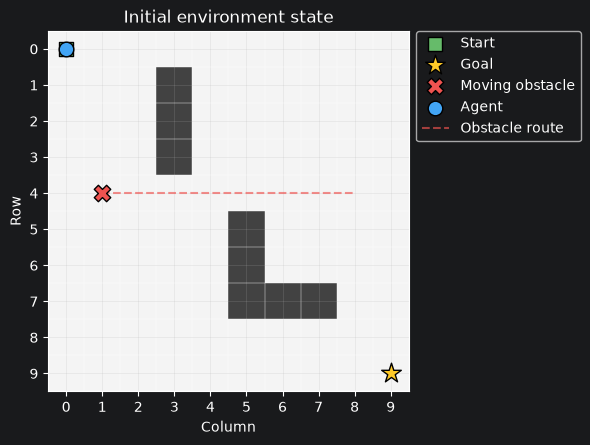
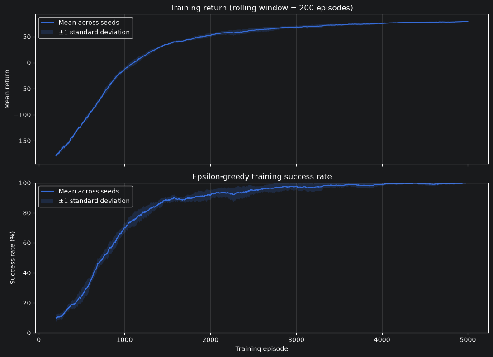
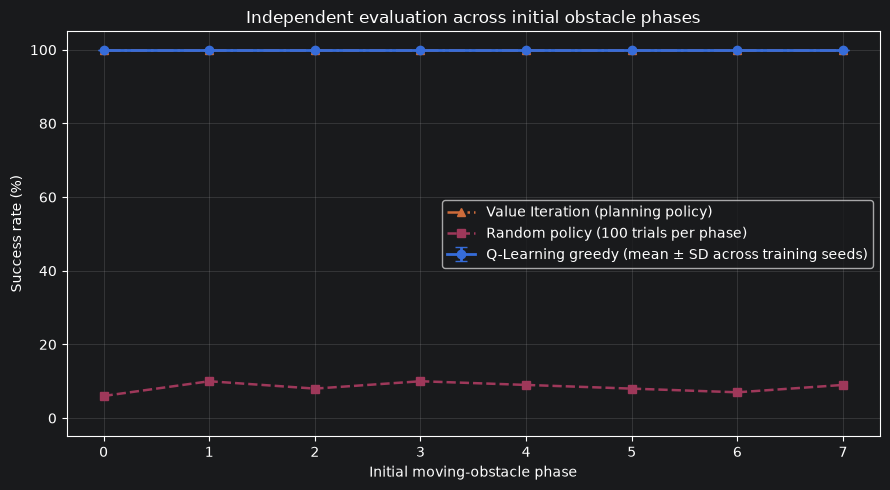
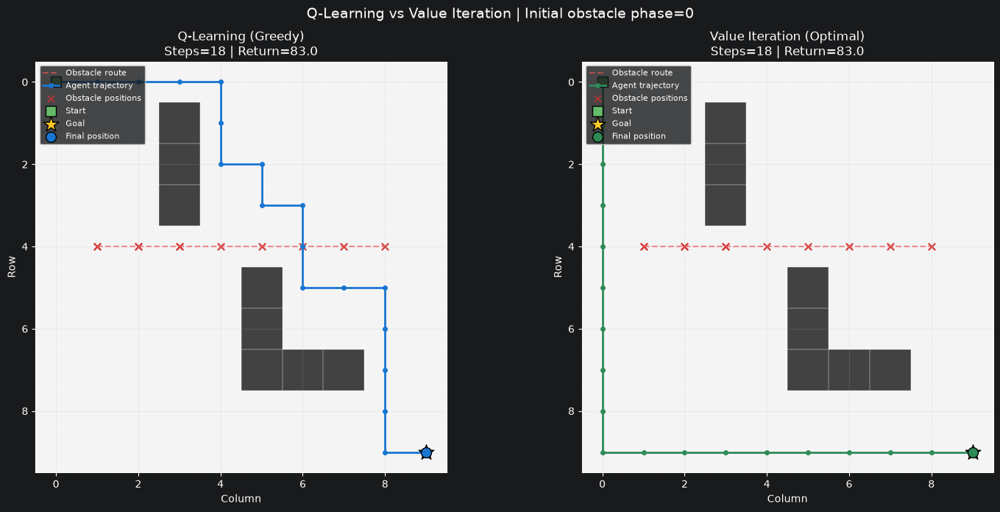

# Basic GridWorld: Tabular Q-Learning (From Scratch)

A 10×10 deterministic GridWorld in which a tabular Q-Learning agent learns to reach a goal while avoiding fixed walls and a moving obstacle. The learned greedy policy is evaluated against a random policy and a Value Iteration planning reference.

This project is implemented from scratch in Python, including the GridWorld environment, transition logic, and tabular Q-Learning agent.

## Environment

The moving obstacle travels horizontally along row 4, cycling through columns 1–8. The agent moves first; the obstacle advances afterward, and collision detection uses the obstacle's updated position.

| Property | Setting |
|---|---|
| Grid | 10 × 10 |
| Start | `(0, 0)` |
| Goal | `(9, 9)` |
| Fixed walls | 8 cells |
| Moving obstacle route | `(4, 1)` through `(4, 8)`, cyclic |
| Actions | Up, Down, Left, Right |
| State | `(agent_row, agent_col, obstacle_phase)` |
| Number of obstacle phases | 8 |
| Episode time limit | 200 steps |

### Rewards

| Event | Reward |
|---|---:|
| Reach the goal | +100 |
| Collide with the moving obstacle | -10 |
| Attempt to enter a wall or leave the grid | -5 |
| Valid non-terminal move | -1 |

Reaching the goal or colliding with the moving obstacle terminates an episode. Reaching the 200-step limit truncates it.

## Q-Learning

The Q-table stores one value for every state-action pair:

`Q.shape = (10, 10, 8, 4)`

Five independent Q-Learning agents are trained with random seeds `11`, `22`, `33`, `44`, and `55`. Each agent is trained for 5,000 episodes, with all training episodes starting at obstacle phase 0. Training uses an epsilon-greedy behavior policy.

### Training configuration

| Parameter | Value |
|---|---:|
| Episodes per run | 5,000 |
| Independent training seeds | 5 |
| Learning rate (α) | 0.1 |
| Discount factor (γ) | 0.99 |
| Initial ε | 1.0 |
| Minimum ε | 0.05 |
| ε decay | 0.9995 |
| Maximum steps per episode | 200 |

### Training progress

The plots show the rolling training return and success rate (rolling window: 200 episodes). The solid line is the mean across the five seeds; the shaded area represents ±1 standard deviation. These are epsilon-greedy training metrics, so exploration can still cause occasional failures.

## Evaluation

The trained Q-Learning policies are evaluated greedily (`ε = 0`) from all eight possible initial obstacle phases. The random baseline uses 100 episodes per phase. Value Iteration is computed from the known transition model and is included as a planning reference, not as another learned agent.

### Main results

| Policy | Success rate | Collision rate | Timeout rate | Mean return | Discounted return | Mean steps |
|---|---:|---:|---:|---:|---:|---:|
| Q-Learning (greedy) | 100.0% ± 0.0% | 0.0% ± 0.0% | 0.0% ± 0.0% | 79.95 ± 1.01 | 64.60 ± 1.41 | 19.45 ± 0.63 |
| Value Iteration | 100.0% ± 0.0% | 0.0% ± 0.0% | 0.0% ± 0.0% | 83.00 ± 0.00 | 68.59 ± 0.00 | 18.00 ± 0.00 |
| Random policy | 8.4% ± 1.4% | 71.6% ± 6.2% | 20.0% ± 6.2% | -190.54 ± 14.67 | -109.50 ± 5.50 | 108.09 ± 8.87 |

The reported standard deviations are calculated across the five training seeds for Q-Learning (after averaging each agent over the eight phases), across the eight phases for Value Iteration, and across the eight phase-level averages for the random policy.

### Success rate for each initial obstacle phase

All five trained Q-Learning agents achieved a 100% success rate in every tested phase. The random policy achieved between 6% and 10% success, depending on the initial phase.

## What the learned policy does

The following figure shows an example greedy Q-Learning trajectory from initial obstacle phase 0, alongside the Value Iteration trajectory for the same initial phase. The Q-Learning agent reaches the goal in 18 steps with a return of 83. In this example, Value Iteration also reaches the goal in 18 steps with a return of 83.

The plotted paths show how the agent navigates around the fixed wall structures while the moving obstacle cycles along row 4. The red dashed line marks the obstacle's full route; red crosses indicate its phase-dependent positions.

## Value Iteration reference

Value Iteration uses the environment's known transition model to compute an optimal planning policy. It converged in 19 sweeps. The optimal discounted value at the start state was `68.5886` for each of the eight initial obstacle phases.

## Notebook contents

- GridWorld environment implementation and transition logic
- Tests for deterministic transitions, collisions, goal termination, and time-limit truncation
- Tabular Q-Learning implementation
- Training across five independent random seeds
- Training return and success-rate curves
- Greedy evaluation across all eight obstacle phases
- Random-policy baseline
- Value Iteration planning reference
- Evaluation tables and plots
- Example Q-Learning and Value Iteration trajectories
- Trajectory animation in the notebook
- Optional Q-table export

## Scope and limitations

The map, start position, goal position, and moving-obstacle route remain fixed throughout the experiments. Testing all eight obstacle phases checks different starting timings of the same obstacle; it does not test generalization to unseen maps or different start and goal positions. The tabular Q-table is appropriate for this small discrete state space, but it does not scale well to large or continuous environments.

